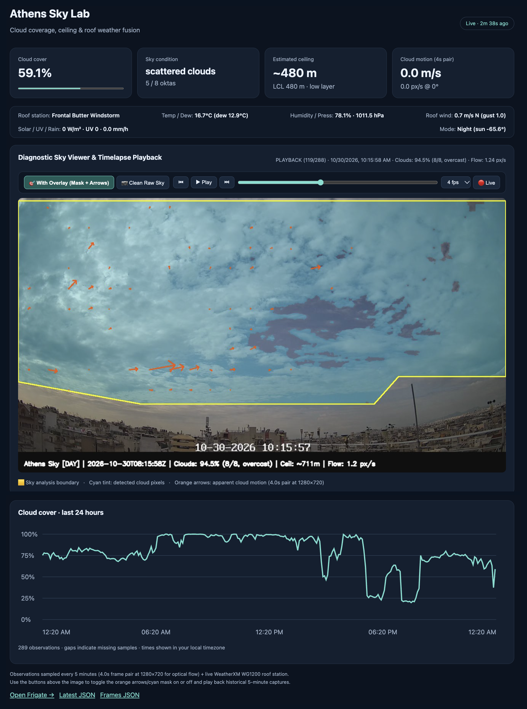
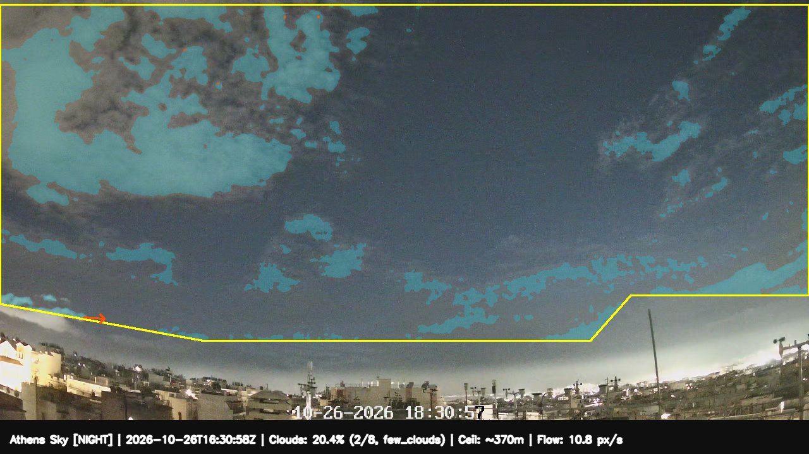

# Jetson Sky NVR (`jetson-sky-nvr`)

Edge NVR and real-time **Sky Computer-Vision & Cloud Ceiling Laboratory** running on an **NVIDIA Jetson Xavier NX** (L4T R35.6.5 / JetPack 5.1.6).

### Live Dashboard & Diagnostic Timelapse Player (`:8080`)


### Nighttime Urban Light-Dome Detrended Cloud Mask


---

## What This Project Does

`jetson-sky-nvr` combines a hardware-accelerated **Frigate 0.18.2 NVR** stack with **`sky-vision`**, a standalone atmospheric computer-vision service that turns a fixed sky-facing IP camera and a co-located roof weather station into an automated cloud-cover, optical-flow, and cloud-ceiling sensor:

1. **Frigate NVR (`0.18.2-tensorrt-jp5` on JetPack 5):**
   - Ports upstream **Frigate `v0.18.2`** onto JetPack 5 (`CUDA 11.4`, `TensorRT 8.5.2.2`, `onnxruntime-gpu 1.19.2`).
   - Decodes the high-resolution `2560×1440` H.265 camera stream on the Jetson's hardware **NVDEC** engine (`preset-jetson-h265` / `hevc_nvmpi`).
   - Runs **YOLOv9 (`yolov9-s-320.onnx`)** object detection on the GPU via an **FP16 TensorRT `.engine`** (`~9–18 ms` inference).
   - Restreams the raw camera feed locally via `go2rtc` (`rtsp://frigate:8554/athens_sky`) so the camera only serves a single RTSP connection, and ingests the annotated `sky-vision` output back into Frigate as a second live camera tile (`athens_sky_vision`).

2. **Sky Computer-Vision & Ceiling Lab (`sky-vision`):**
   - Samples `2560×1440` frame pairs (`4.0s` apart) from Frigate's local RTSP restream every **5 minutes**.
   - Segments cloud cover (`0–100%` and meteorological **`0–8 oktas`**), classifies WMO sky conditions (`clear`, `few_clouds`, `scattered_clouds`, `broken_clouds`, `overcast`), and measures apparent cloud drift speed and direction.
   - Fuses live roof telemetry from a local **WeatherXM (`WG1200`)** weather gateway (`T`, `RH`, dewpoint, pressure, wind, solar irradiance) to estimate **Cloud Base Height / Ceiling (`m` AGL)** and **physical cloud speed (`m/s`)**.
   - Serves a zero-dependency **Live Web Dashboard & Diagnostic Timelapse Player (`:8080`)** and publishes live state + **Home Assistant MQTT Auto-Discovery** topics to `mosquitto`.

---

## How the Sky Classification & Ceiling Pipeline Works

### 1. Custom Polygon Skyline Masking (`build_sky_roi_mask`)
Fixed urban sky cameras inevitably capture rooftops, hillsides, antenna masts, and horizon glare along the bottom of the frame. `sky-vision` applies a tailored polygon Region-of-Interest (ROI) mask (shown in **yellow** in the overlay above) that hugs just above the local skyline—maximizing usable sky area (`71.7%` of the frame) while excluding all buildings, masts, and street lights from both cloud statistics and optical flow.

### 2. Astronomical Solar-Elevation Day / Night Switching (`is_daytime_athens`)
Modern low-light IP cameras use aggressive Automatic Gain Control (AGC) at night, brightening the dark night sky to daytime luminance levels (`luma ~ 90–130`) and desaturating colors. Instead of guessing day vs. night from image brightness, `sky-vision` computes the exact **solar elevation angle** ($\alpha_{\text{sun}}$) from UTC time and station coordinates (`SKY_LAT`, `SKY_LON`), switching cleanly between daytime and nighttime spectral models at $\alpha_{\text{sun}} = -1.0^\circ$.

### 3. Spectral Cloud Segmentation (`compute_cloud_mask_and_fraction`)
- **Daytime Model (`NRBR` + `HSV`):**
  - Clear blue sky scatters short-wavelength blue light strongly ($B \gg R$), while water droplets in clouds scatter red and blue nearly equally ($R \approx B$).
  - Computes the **Normalized Red-Blue Ratio**:
    $$\text{NRBR} = \frac{R - B}{R + B + 1}$$
  - Flags sky pixels as cloud when `(NRBR > -0.08 and V > 0.30)` (gray/broken clouds) or `(S < 0.28 and V > 0.45)` (bright white cumulus/overcast decks), followed by $7\times7$ elliptical morphological open/close cleanup.
- **Nighttime Urban Light-Dome Model (AGC-Aware):**
  - At night in an urban basin, ground lights create a smooth directional glow near the horizon, while low/mid clouds reflect warm city light downward.
  - Extrapolates each vertical sky column across the lower boundary and estimates the smooth **2D background light-pollution dome** (`dome_2d`) via downsampled Gaussian filtering.
  - Subtracts `dome_2d` from local sky luminance to isolate structured illuminated cloud bands (`cloud_residual > 2.4` and `NRBR > -0.095`), with a zenith brightness/warmth check (`zenith_luma > 98` and `zenith_nrbr > -0.035`) to catch solid low overcast decks.

### 4. WMO Oktas & Sky Condition Mapping
From `cloud_fraction = cloud_pixels / sky_pixels`, `sky-vision` computes `oktas = round(cloud_fraction * 8)` and classifies the sky state:
- `< 12.5%` (`0–1 oktas`) → **`clear`**
- `12.5% – 37.5%` (`2–3 oktas`) → **`few_clouds`**
- `37.5% – 62.5%` (`4–5 oktas`) → **`scattered_clouds`**
- `62.5% – 87.5%` (`6–7 oktas`) → **`broken_clouds`**
- `>= 87.5%` (`8 oktas`) → **`overcast`**

### 5. Cloud-Gated Optical Flow (`compute_sky_optical_flow`)
- Captures two frames separated by **`4.0 seconds`** (`FLOW_DT_SEC=4.0`) and runs **dense Farnebäck optical flow** at `1280×720` (`scale=0.5`, 4-level pyramid, `winsize=25`) with a $5\times5$ Gaussian pre-filter.
- A 4-second baseline at `1280×720` yields $8\times$ larger pixel displacements than a 1-second `640×360` pair, lifting slow $1\text{–}3\text{ m/s}$ cloud drift cleanly above H.265 compression noise.
- Flow vectors are **gated by the active cloud mask (`sky_mask & cloud_mask`)** so clear sky and buildings never generate false motion arrows.

### 6. Roof Weather Station Fusion & Cloud Ceiling Estimation
When pointed at a local **WeatherXM WG1200** gateway (`WXM_STATUS_URL`), `sky-vision` fuses surface thermodynamics with camera vision:
- **Dewpoint & Lifted Condensation Level (LCL):**
  $$H_{\text{LCL}} \approx 125 \cdot (T - T_{\text{dew}}) \quad \text{(meters AGL)}$$
- **Estimated Ceiling (`estimated_ceiling_m`):** Combines $H_{\text{LCL}}$ with visual cloud presence, nighttime reflectance, and daytime **Clear-Sky Index ($K_t$)** (measured solar irradiance vs. Haurwitz theoretical clear-sky irradiance at $\alpha_{\text{sun}}$) to estimate the active cloud base height.
- **Physical Cloud Drift Speed (`cloud_speed_m_s`):** Converts angular optical flow (`px/s` $\to$ `rad/s`) at `estimated_ceiling_m` into physical cloud speed in **$\text{m/s}$**.

---

## Live Interfaces

1. **Diagnostic Web Dashboard & Timelapse Player (`http://<JETSON_IP>:8080`):**
   - Live cards for **Cloud Cover (`%`)**, **Sky Condition (`oktas`)**, **Estimated Ceiling (`m` AGL + LCL)**, **Cloud Motion (`m/s` & `px/s`)**, and **Roof Weather Station** telemetry.
   - **Interactive Timelapse & Layer Toggle:** Stores paired `1280×720` snapshots every 5 minutes—both **With Overlay (`debug/`)** and **Clean Raw Sky (`raw/`)**—allowing instant toggling of the cyan mask and orange motion arrows on any live or historical frame, plus variable-speed (`2 / 4 / 8 fps`) timelapse playback.
   - Rolling **24-hour Cloud Cover SVG chart** and JSON endpoints (`/api/latest`, `/api/history`, `/api/frames`).
2. **Frigate NVR UI (`http://<JETSON_IP>:5000`):**
   - Displays both the raw hardware-decoded H.265 camera (`athens_sky`) and the live annotated classification tile (`athens_sky_vision`).
3. **MQTT & Home Assistant Auto-Discovery (`mosquitto`):**
   - Publishes JSON observations to `sky_vision/athens/state`, JPEG overlays to `sky_vision/athens/debug_image`, and auto-registers 7 sensors under `homeassistant/sensor/sky_vision_athens/*/config`.

---

## Quick Start

1. Copy `.env.example` to `~/.config/jetson-sky-nvr/.env` (`chmod 600`) and fill in your camera credentials and optional local WeatherXM gateway URL:
   ```bash
   mkdir -p ~/.config/jetson-sky-nvr
   cp .env.example ~/.config/jetson-sky-nvr/.env
   chmod 600 ~/.config/jetson-sky-nvr/.env
   ```
2. Bootstrap the Jetson host and start the stack:
   ```bash
   ./scripts/bootstrap-host.sh
   docker compose --env-file ~/.config/jetson-sky-nvr/.env up -d
   ```
3. Run healthchecks and unit tests:
   ```bash
   ./scripts/healthcheck.sh
   docker exec sky-vision pytest -q
   ```

See [`docs/OPERATIONS.md`](docs/OPERATIONS.md) and [`docs/RECOVERY.md`](docs/RECOVERY.md) for single-service updates and rollback procedures.
